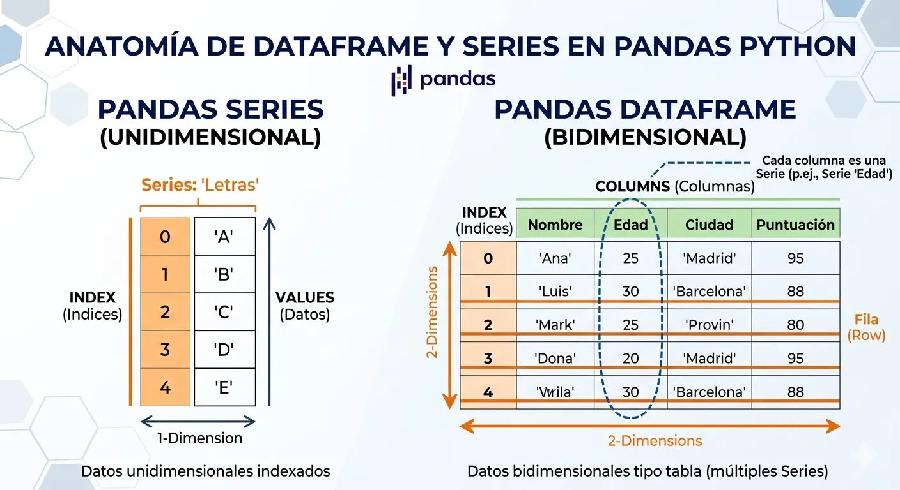
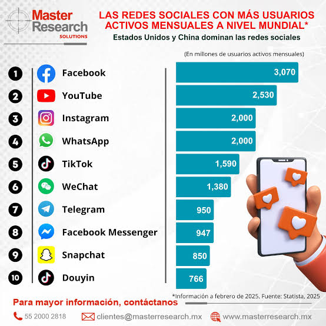
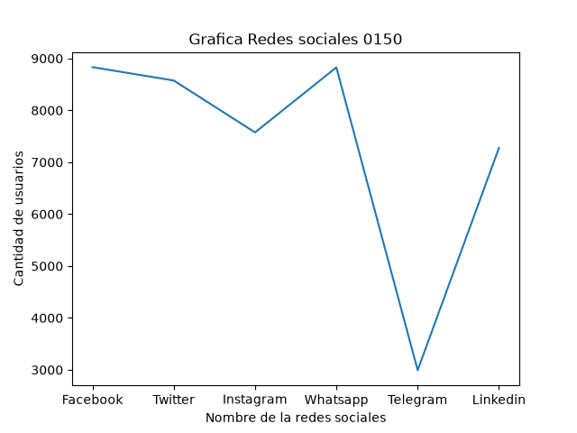
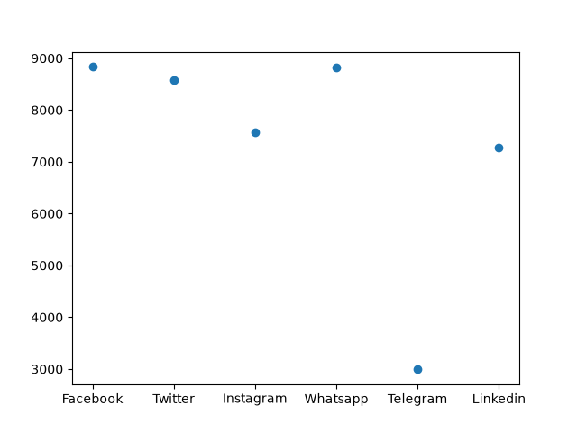
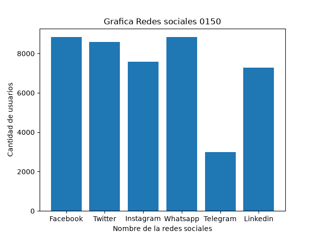
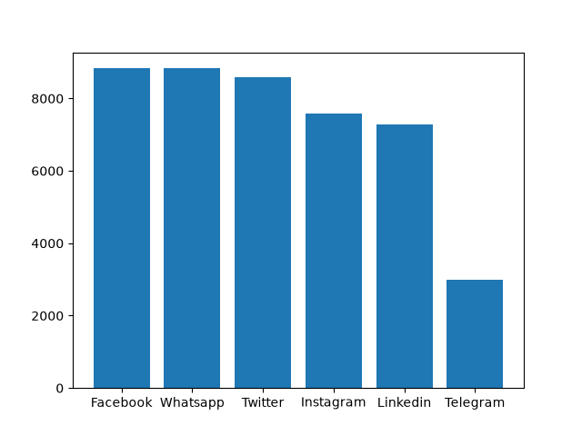
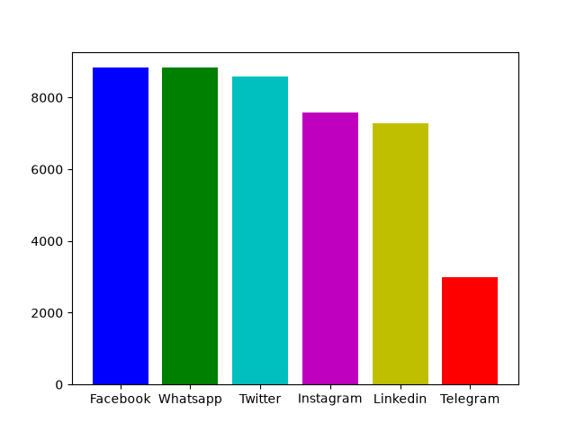
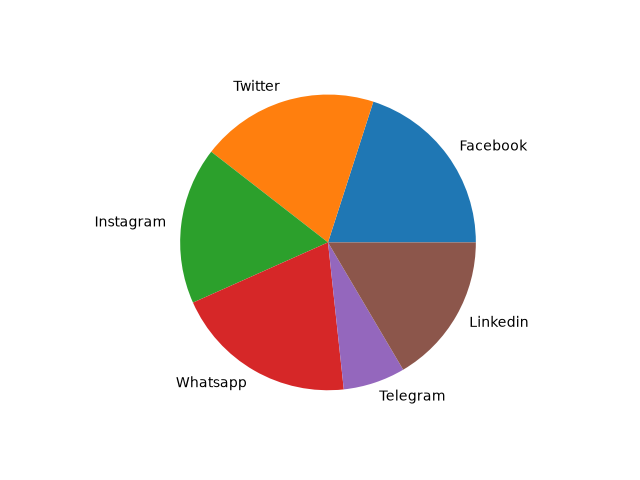

##  Dataframe o marco de datos pandas

## Redes sociales mas usadas a nivel global en el año 2025

## La grafica

## La grafica de puntos

## grafica de barras

# Grafica de barras ordenada 

## Grafica de colores barra

# Grafica de pastel
